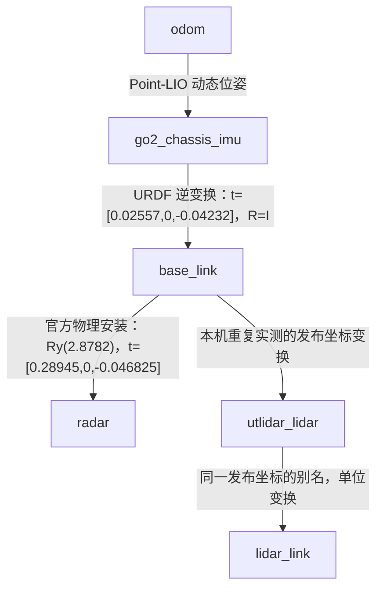
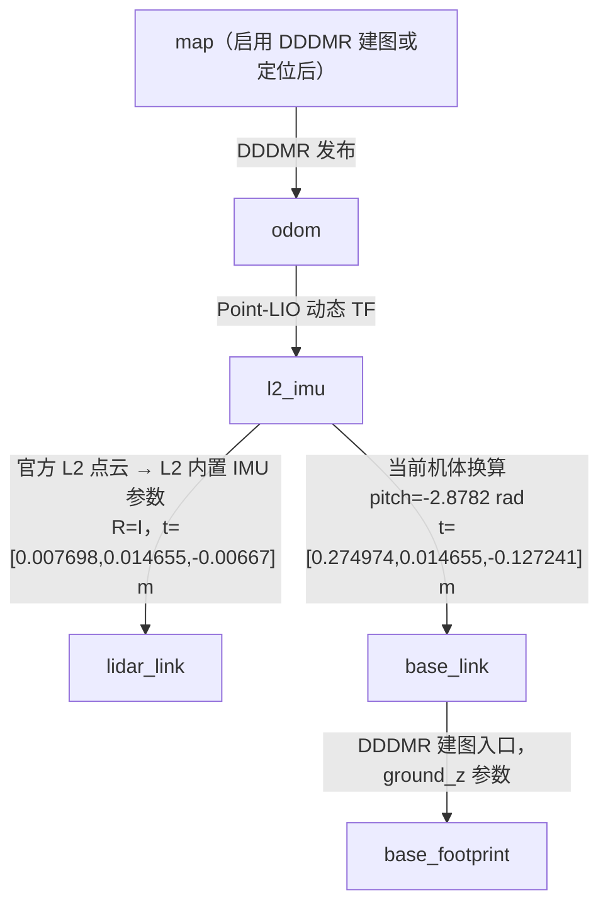

# 实机启动代码的 TF 链条核查

## 2026-11-25 当前机体 IMU 路径

- `T_base_chassisIMU`：URDF 的机体 IMU，R=I，t=[-0.02557,0,0.04232] m。
- `T_base_radar`：物理雷达模型安装，不被发布坐标的实测结果替换。
- `T_base_publishedCloud`：实测 `p_base = R*p_cloud+t`，R 和 t 见 `shared/dddmr/real/go2_published_cloud_geometry.json`，t≈[0.28216,0,0] m。重连后 24485 对点复测，误差中位约 0.17 微米，表示两个固件发布点云之间的刚体关系。
- `T_chassisIMU_publishedCloud`：R 与上一项相同，t≈[0.30773,0,-0.04232] m。Point-LIO 显式使用这组外参，将发布点云转换到机体 IMU 坐标。

`/odom` 的 child 是 `base_link`。Point-LIO 发布 odom→go2_chassis_imu，适配器只发布 Odometry 消息，避免重复 TF。静止检查机体 Z 朝上、地面 0.44°，证据 `experiments/EXP-0024/shared-profile-check.json`。不以把初始姿态强制设零、冻结估计或修改真实 IMU 来消除翻转。

以下保留此前 L2 内置 IMU 路径的核查过程，不能当作当前已通过的机体路径。

2026-11-24，核对 shared/dddmr/real/point_lio_l2.launch.py 与 body_odometry.py，证据归入 EXP-0022。

图中箭头表示父坐标系到子坐标系的 TF 关系，参数表示子坐标系在父坐标系中的位姿。坐标换算写作 p_parent = R_parent_child*p_child + t_parent_child。

Point-LIO 单独启动时没有 map→odom 和 base_link→base_footprint。body_odometry.py 使用同一条 l2_imu→base_link 变换将 /aft_mapped_to_init 转成 /odom 消息，未另发一条直接 odom→base_link 的 TF。DDDMR 实机生成配置已关闭外部 odom TF 重发。

## 当前明确的问题

原回放保存的 /odom 消息可反推换算前的 Point-LIO IMU 姿态。逆掉适配器固定 Ry(-2.8782) 后，其 RPY 约 [-1.42,-25.22,1.05] 度，IMU Z 轴在 odom 中为 [-0.426,0.017,0.904]。适配器合成后，机体 Z 轴为 [0.176,-0.021,-0.984]，指向下方。翻转产生在合成的 L2 内置 IMU→Go2 机体这条边。该数值由官方模型雷达安装姿态加平行内部轴假设推导，尚未验证它对应本机固件发布的坐标定义。矩阵求逆运算本身并没有符号计算错误。

这项结果没有证明官方 L2 点云→L2 内置 IMU 参数错误，也没有完成该参数在当前数据上的精度验收。官方内部外参继续保留。

消息中的输入 frame_id 为 utlidar_lidar 和 utlidar_imu，启动文件里却使用 lidar_link 和 l2_imu。Point-LIO 按配置和消息数值工作，并不自动查 TF 转换这些输入。当前没有显式的两组同义 frame 连接。确认实际轴向后应统一发布 frame 命名或补经过核对的别名 TF，不能单靠改消息名字改变数据坐标。

## 已有实测变换的归属

EXP-0018 配对拟合的是 utlidar_lidar→原厂 base_link 的点坐标转换，平移约 [0.28216,0,0] m，旋转矩阵保存于 EXP-0022/imu-axis-check.json。它连接点云和机体，不能直接替换图中 IMU→机体边。应用该变换与官方内部关系后能构造候选 IMU→机体，需要再与原始 IMU 位姿、重力以及配准点云共同回放验证。

当前排错顺序为保留官方内部外参，检查原始 Point-LIO 位姿与配准点云地面方向，再修正机体变换和 frame 命名，最后接回 DDDMR。所有实机运动由用户操作。

## 2026-11-25 对应关系与诊断更正

用户明确确认 URDF radar 与实机雷达坐标对应，当前配置按这一前提使用。官方两个变换组成 T_base_imu = T_base_lidar * inverse(T_imu_lidar)，再取逆得到 T_imu_base。复核结果与当前代码数值一致，乘回雷达变换的数值误差为零。记录 experiments/EXP-0024/official-frame-composition.json。

此前观察到合成后机体翻转，只定位了异常在输出中出现的位置，不能据此认定这条固定外参本身错误。Point-LIO 在机体变换之前已经出现严重漂移，尚未通过前端验收。-123 度来自原厂 cloud_base 输出的有效拟合，未证实其是否包含额外软件处理，不能把该拟合角当成缺失安装外参加入配置。保留官方组合，继续查前端输入、消息转换与滤波。
