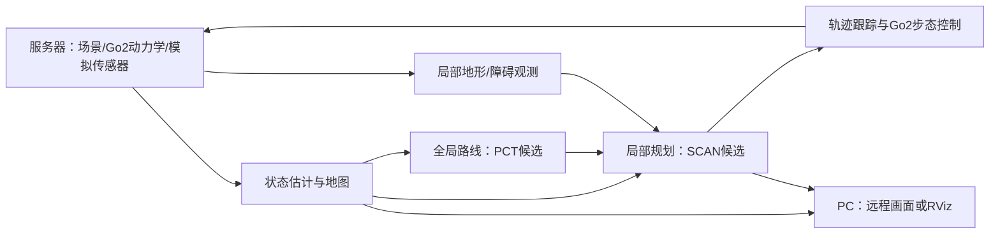

# 仿真优先的 Go2 导航准备

更新：2026-11-23。当前仅准备本地文件，未连接服务器/机器狗，未安装或运行候选。

## 模块定位

| 模块 | 职责 | 候选与边界 |
|---|---|---|
| 仿真环境 | 场景、接触动力学、关节、传感器生成 | Gazebo/MuJoCo/Isaac 系列待按控制器与传感器支持选型；项目自带运动学演示不能替代动力学验收 |
| 状态估计和建图 | 雷达/IMU得到位姿、地图；长期运行需要回环/重定位 | L1适配Point-LIO等；原始点时间和IMU适配未验 |
| 地形感知 | 区分地面、障碍、台阶、下落边缘 | 保留三维几何，D435i可提供近距补充；不是统一按高度删点 |
| 全局路线 | 在建筑/多层地图上选择通路 | PCT：PCD构造tomogram，再做全局规划；不负责SLAM或关节控制 |
| 局部轨迹/动作 | 根据近期观测绕障、跟踪路线 | SCAN：路线引导的局部三维规划；NeuPAN：二维点障碍下MPC运动规划并输出动作。二者为候选，不默认串联 |
| 四足运动执行 | 将机体运动请求转换为稳定步态/关节动作 | 选定Go2模型匹配的控制器/策略；不能假定速度话题就能驱动任意仿真模型上下楼 |
| 显示 | 场景、地图、轨迹、相机与指标 | PC可只显示远程桌面，也可本地RViz；后者仍有本地图形负载 |

NeuPAN的map-free不表示无需定位参考、无需目标或能解决整栋楼全局路线。其公开FAQ明确输入二维障碍点；差速/Ackermann/omni模型未包含Go2足端接触或三维台阶。3D点云投影到二维不等于支持跨楼层通行。主ROS封装为Noetic，文档链接的ROS2封装由社区维护。

PCT与SCAN可作为“全局路线→局部轨迹”的候选组合，但坐标、路径格式/采样、可通行性、重规划和跟踪接口尚未适配，不能宣称即插即用。NeuPAN适合作为单层避障对照；跨层时也可研究分段调用，但楼梯切换和三维可行性需另做设计。

## 运行架构（拟议）

NeuPAN走平地对照分支，替换相应局部规划/动作输出段，避免与SCAN重复发命令。DDDMR作为整栈替代，不是上述所有模块之外还要再叠加的部件。

服务器承担闭环计算；PC显示不限定计算在哪台机器。先仿真后实机，实机替换传感器来源和执行适配；关闭仿真时钟，恢复真实采集时间与跨机同步。网络可达和吞吐未验。脱网自主目标再迁移至机载，而非本次准备前置。

## 两级仿真验收

1. 算法级：固定场景/路线与位姿，验证全局路径、局部避障和接口。使用真值位姿必须明确标注，不能记为SLAM通过。
2. 闭环级：模拟原始传感器→估计位姿→感知/规划→四足控制→接触动力学。检验楼梯碰撞、支撑、跟踪和恢复；只移动机体位姿或播放腿部动画不算通过。完整传感器闭环之前，先单独验证控制器在具体台阶的能力。

场景依次为平走廊、静态障碍、动态障碍、平台、楼梯上行、下行和多层路线。记录场景、初始状态、种子、参数和失败例；指标包含到达/碰撞/跌倒、跟踪误差、估计误差、规划耗时、超时比例及仿真实时因子。数值阈值在模型/尺寸/传感器频率确定后设定，不臆造性能达标。

## 连接服务器前能完成的准备

- [x] 核对作者资料与模块职责，保存来源清单。
- [x] 整理接口约定与仿真到实机差异。
- [ ] 根据四足控制、L1近似传感器和深度相机支持选定仿真器与Go2模型；目前不默认锁定Gazebo。
- [ ] 锁定仓库commit、控制器/模型资产和许可证，再制作对应容器和启动脚本。sources.json目前是选型清单，不是依赖锁文件。
- [ ] 联通后先验证无界面最小场景、控制器和传感器，再加入定位/规划。各阶段保留日志与回放证据。

## 原始来源

- [PCT作者实现](https://github.com/byangw/PCT_planner)：Noetic、CUDA/CuPy的地图构造和全局规划。
- [SCAN作者实现](https://github.com/wuyi2121/SCAN-Planner)：主线Noetic，ROS2-community分支；run.launch含运动学/开环演示。
- [NeuPAN作者实现](https://github.com/hanruihua/NeuPAN)：README FAQ、limitations、robot配置；优化含CPU求解，学习模块不等同四足强化学习策略。
- [NeuPAN作者ROS封装](https://github.com/hanruihua/neupan_ros)：Noetic；ROS2链接指向第三方维护封装。
- [DDDMR作者实现](https://github.com/dfl-rlab/dddmr_navigation)：ROS2整栈及Gazebo示例，真实参考平台与Go2并不完全相同。
- [宇树L1适配Point-LIO](https://github.com/unitreerobotics/point_lio_unilidar)：官方主线Noetic，Go2内置数据接口还需适配。

本文件为架构与准备说明，不是已验证安装说明。证据与继续条件见EXP-0013。
